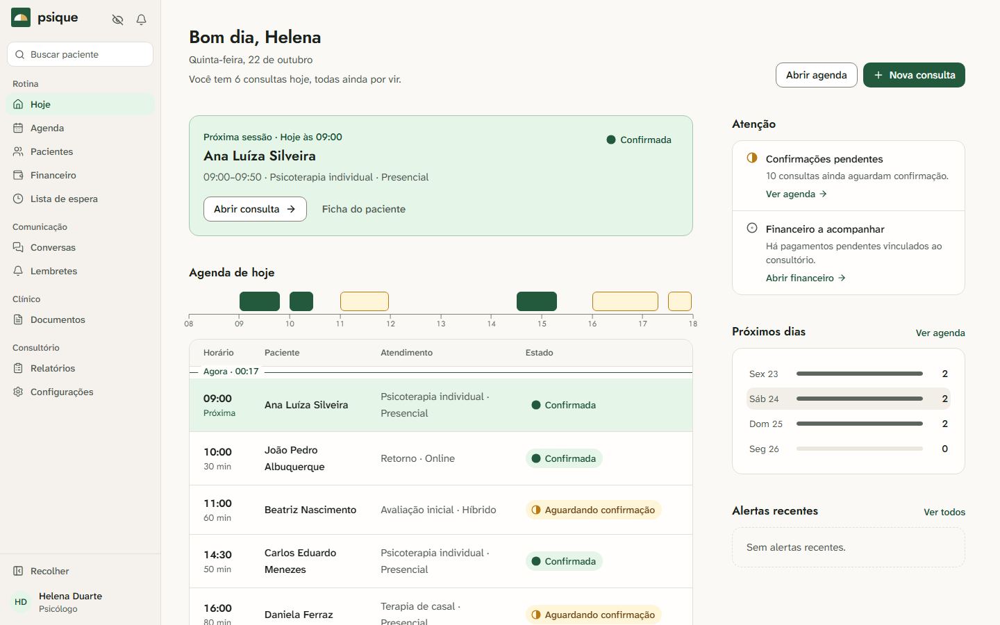
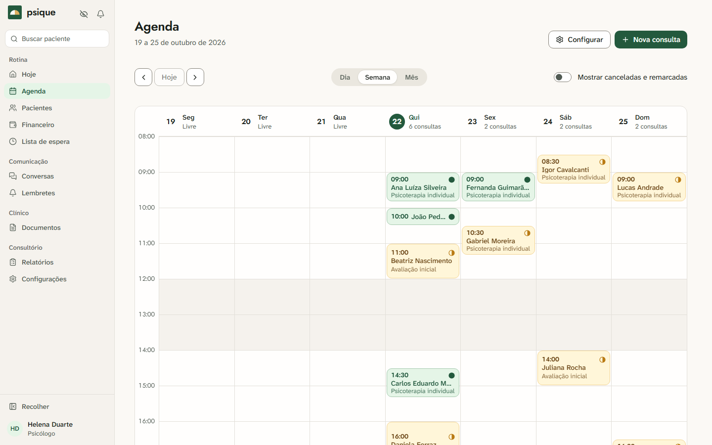
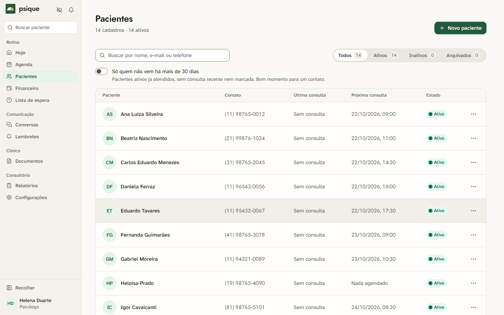
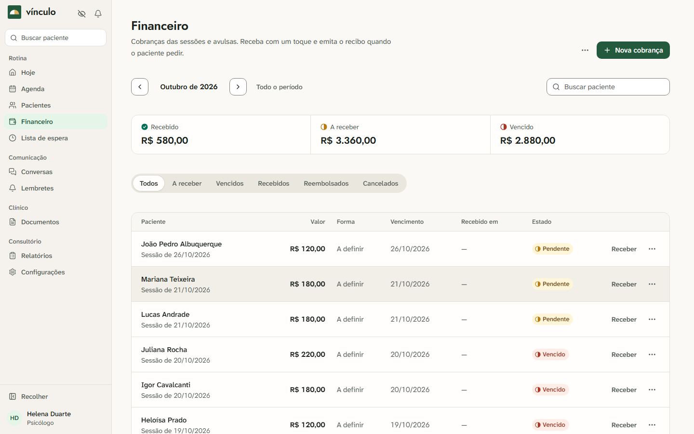
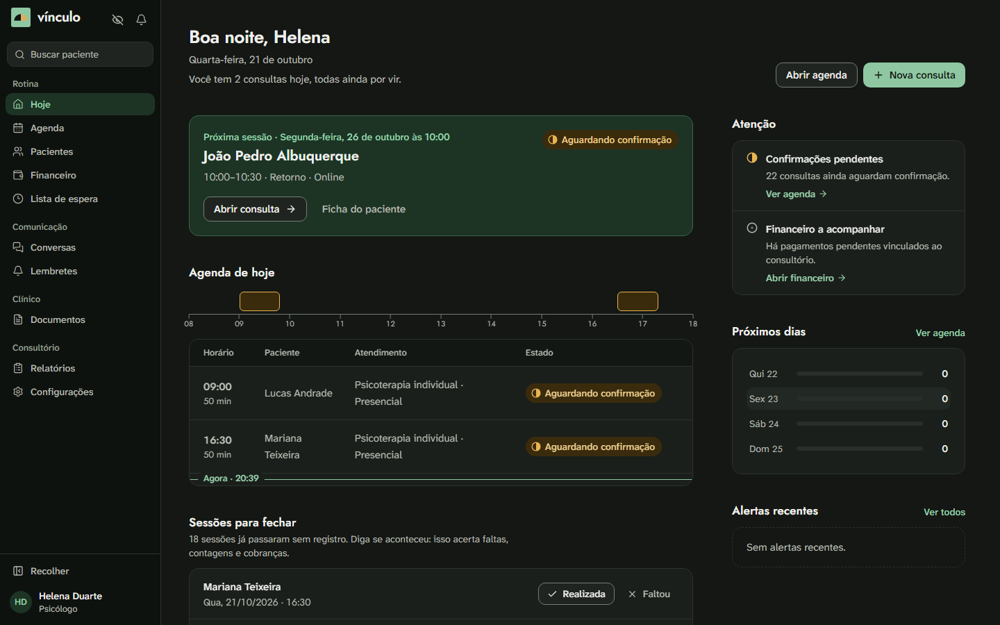
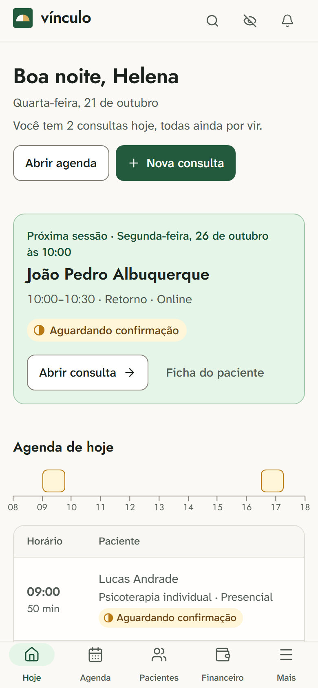
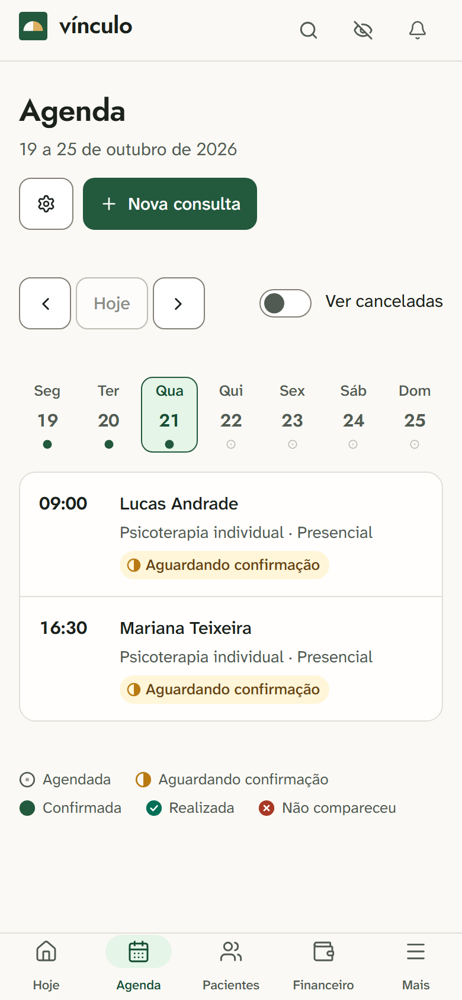

# Vínculo

[](https://github.com/NicolasPortie/gestao-psi/actions/workflows/ci.yml)
[](LICENSE)


Aplicação de gestão para consultórios de psicólogos autônomos. Organiza pacientes,
agenda, consultas, prontuário e pagamentos, com separação entre acesso administrativo
e clínico e isolamento dos dados por conta.



## Telas

Todas as telas abaixo usam dados fictícios.

| Agenda semanal | Pacientes |
| --- | --- |
|  |  |

| Financeiro | Tema escuro |
| --- | --- |
|  |  |

| Acesso | Celular |
| --- | --- |
|  |   |

## Destaques técnicos

- **Isolamento por conta:** toda consulta ao banco é escopada pela conta da sessão autenticada; o front-end nunca informa a conta.
- **Dados pessoais cifrados** no banco, com chaveiro de proteção de dados compartilhado via Redis.
- **Separação entre dados administrativos e clínicos**, com perfis de acesso e trilha de auditoria.
- **Sessão segura:** token de acesso só em memória e renovação por cookie protegido.
- **Agenda sem conflitos:** transação serializável contra marcações concorrentes, fuso horário por conta e regras de antecedência para cancelar e remarcar.
- **Acessível:** varredura automática WCAG A/AA nos temas claro e escuro, navegação por teclado e respeito a `prefers-reduced-motion`.
- **Pronto para implantar:** Docker Compose para desenvolvimento e produção (HTTPS automático, e-mail e backup periódico).

> **Nome técnico.** O produto se chama Vínculo. Pastas, projetos, namespaces e o banco continuam como
> `GestaoPsi` para não quebrar migrações, dados e integrações; o nome visível ao usuário vive em
> `frontend/src/app/core/marca.ts` e no `appsettings.json` (remetente de e-mail).

## Stack e organização

- Frontend: React, TypeScript estrito, Vite, React Router em Data Mode,
  TanStack Query, React Hook Form, Zod, Tailwind CSS e Lucide. Sistema de
  design próprio ([DESIGN.md](DESIGN.md)) sobre Base UI e Sonner, com tema
  claro e escuro.
- Backend: ASP.NET Core Web API, Controllers, Services, EF Core e SQL Server.
- Redis: autenticação temporária e chaveiro compartilhado de proteção de dados.
- Verificação: xUnit, Vitest, Testing Library e Playwright.

As telas ficam em `frontend/src/app/features/`. As regras de negócio ficam nos
serviços do backend. Contratos externos usam DTOs; a conta é obtida da sessão
autenticada. Consulte [arquitetura](docs/02-arquitetura/),
[modelagem](docs/03-modelagem/) e [glossário](GLOSSARY.md).

## Executar em desenvolvimento

Requisitos: .NET SDK 10, Node.js 22.12 ou superior, npm e SQL Server.
No Windows, a configuração padrão usa SQL Server LocalDB.

Na raiz do repositório:

```powershell
dotnet tool install --global dotnet-ef --version 10.0.9
dotnet ef database update --project backend/GestaoPsi.Api
dotnet run --project backend/GestaoPsi.Api --launch-profile http
```

Em outro terminal:

```powershell
cd frontend
npm ci
npm run dev
```

Abra `http://localhost:4200` e crie uma conta pela tela de cadastro. Para
explorar com dados fictícios, deixe a API rodando e execute `npm run seed:demo`
em `frontend/`; ele cria uma conta de demonstração (credenciais no próprio script).
A API usa `http://localhost:5178`; seu documento OpenAPI em Development está em
`/openapi/v1.json`, e a saúde das dependências em `/api/v1/saude`.

Para outro SQL Server, defina `ConnectionStrings__DefaultConnection` no ambiente
antes dos comandos .NET. Em Development, a ausência de `ConnectionStrings__Redis`
ativa estado de autenticação em memória. Esse estado se perde no reinício.
As chaves locais de Data Protection ficam em `.gestaopsi-dev`, ignorada pelo Git;
preserve essas chaves para conseguir ler dados já criptografados.

## Ambiente Docker local

Requisitos: Docker com engine Linux ativo e Docker Compose.
Copie `.env.example` para `.env` e preencha `JWT_CHAVE`, `HASH_CHAVE`,
`SQL_SENHA` e `REDIS_SENHA`. A senha do SQL Server precisa atender aos requisitos
de complexidade do servidor. Para gerar as duas chaves em PowerShell:

```powershell
[Convert]::ToHexString([Security.Cryptography.RandomNumberGenerator]::GetBytes(32))
[Convert]::ToBase64String([Security.Cryptography.RandomNumberGenerator]::GetBytes(32))
```

Use a primeira em `JWT_CHAVE` e a segunda em `HASH_CHAVE`.

```powershell
docker compose config --quiet
docker compose up --build
```

O serviço `migracoes` aplica o bundle EF antes da inicialização da API.
O frontend fica em `http://localhost:4200`. Portas externas são restritas ao
localhost e volumes preservam SQL Server e Redis. A persistência do Redis inclui
o chaveiro de proteção dos dados; perder esse chaveiro compromete a leitura do
conteúdo criptografado. Este Compose é para uso local em HTTP; para produção, veja abaixo.

## Produção

O [guia de implantação](docs/05-operacao/IMPLANTACAO.md) sobe o sistema num servidor Linux com
`docker-compose.producao.yml`: HTTPS automático pelo Caddy, e-mail obrigatório, certificado para as
chaves de cifra e backup periódico do banco e do chaveiro, com script de restauração testado.

## Verificações

```powershell
dotnet build backend/GestaoPsi.slnx --nologo
dotnet test backend/GestaoPsi.Api.Tests/GestaoPsi.Api.Tests.csproj --nologo
cd frontend
npm run lint
npm run typecheck
npm test
npm run contraste
npm run build
npm audit
npx playwright install chromium
npm run test:e2e
```

Os testes E2E exigem frontend e API ativos nas portas acima (o `docker-compose` serve para isso).
Eles incluem a varredura de acessibilidade (axe, WCAG A e AA) nos dois temas.
O cadastro tem limite de contas novas por hora e por IP; reinicie a API de desenvolvimento ou
eleve `MAXIMO_CADASTROS_POR_HORA` se o atingir. Eles criam dados
fictícios em contas de QA, exercitam desktop e mobile (inclusive a ausência de
rolagem horizontal no celular), e não devem ser executados em um banco com dados
reais de atendimento.

## Segurança da camada HTTP

- A API responde com `Cache-Control: no-store`, `nosniff`, `X-Frame-Options: DENY` e uma CSP restritiva.
- O nginx do front aplica CSP sem scripts embutidos, `frame-ancestors 'none'` e demais cabeçalhos.
  Em produção, o Caddy termina o HTTPS e envia `Strict-Transport-Security`; a API também usa HSTS fora de Development.
- Endpoints sem sessão (cadastro, login, recuperação e webhook do Bridge) têm limite de 60 requisições por minuto por IP.
- Atrás de proxy reverso, defina `Rede__ConfiarEmProxyReverso=true` para a API usar o IP real do cliente
  (X-Forwarded-For, aceito só de redes privadas). O `docker-compose` já faz isso. Sem a opção, todos os
  clientes aparecem com o IP do proxy e compartilham o mesmo limite.
- `/api/v1/saude` não detalha a infraestrutura fora de Development.

## Funcionalidades e limites

Há telas e contratos para pacientes, consultas e remarcação, configuração da
agenda, sessões e evoluções, pagamentos manuais, lista de espera, lembretes,
modelos de mensagem, documentos, relatórios, equipe, auditoria e WhatsApp Bridge.
As configurações ficam reunidas em `/configuracoes`, inclusive Conta e segurança, onde
o usuário troca a senha (as demais sessões são encerradas). O cadastro leva aos termos de uso
(`/termos`) e à política de privacidade (`/privacidade`), públicos e versionados. Esses textos
descrevem o que o sistema faz hoje e são um ponto de partida: **revise com assessoria jurídica
e defina o canal de contato antes de operar comercialmente.**
E-mail exige SMTP configurado; WhatsApp exige Bridge externo para entrega.
O bot é administrativo e encaminha mensagens sensíveis ao atendimento humano.

Planos comerciais, cobrança SaaS, portal do paciente e integrações financeiras
pertencem às fases futuras descritas em [MVP e fases](docs/03-modelagem/07-mvp-e-fases.md).

## Demonstração

Com a API em execução, `npm run seed:demo` (em `frontend/`) cria uma conta com dados
fictícios. Um roteiro para explorar: cadastrar paciente, agendar consulta, confirmar e
remarcar, registrar a sessão, lançar um pagamento e gerar um relatório. Entre também com o
perfil de recepção para ver que ele não acessa o prontuário.

## Licença

Distribuído sob a licença MIT. Veja [LICENSE](LICENSE).
